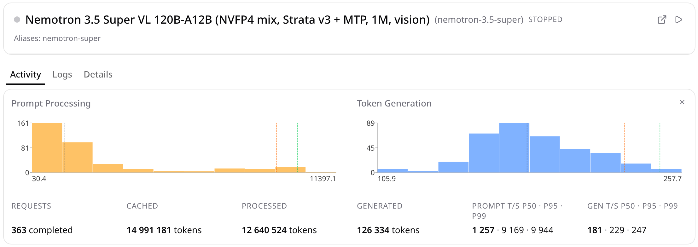

# strata-nemotron: Nemotron 3.5 Super (120B-A12B) on one RTX 5090

A fork of [Strata](https://github.com/Niko1221/Strata). Strata is an inference engine built for large MoE models on
one consumer GPU, with the experts in system RAM. This fork adds **NVIDIA Nemotron 3.5 Super**, a hybrid of Mamba-2,
latent MoE (512 experts, top-22) and 8 full-attention layers, with images (the RADIO encoder through strata-vision).
Strata's existing models are
untouched: the new code sits behind its own architecture in the loader and its own engine binary. On swift15
(Qwen3.8-Flash-Next), the logits after the prompt are bit-identical to upstream, and so are greedy outputs and the
tokenizer.

Weights: [https://huggingface.co/Cudecnik/Nemotron-3.5-Super-120B-A12B-NVFP4-Strata-Blackwell](https://huggingface.co/Cudecnik/Nemotron-3.5-Super-120B-A12B-NVFP4-Strata-Blackwell). `Nemotron-3.5-Super-120B-A12B-NVFP4`, a 71.6 GB GGUF in two shards: NVIDIA's NVFP4 experts kept as they are, the MTP block included.

## Numbers

One machine: RTX 5090 32 GB, i7-14700KF, 128 GB DDR5-5200, PCIe 5, Linux. 1 GB of VRAM is kept free for the
desktop. Greedy, 256 generated tokens on wikitext-2:

| context | prefill, tok/s | decode with MTP | decode without MTP |
|---|---:|---:|---:|
| 4K | 2 277 | 118 | 96 |
| 32K | 9 575 | 186 | 109 |
| 128K | 9 132 | 165 | 95 |
| 256K | 7 336 | 138 | 79 |
| 512K | 5 075 | 107 | 65 |
| 1M | 3 125 (335 s) | 111 | 47 |

Decode here is the **fast** mode (`--skip-w 0.4 --prefetch 0`, the example config's setting: low-weight cache misses are skipped, decode PPL ×1.091
against no skipping). The **precise** mode (`--prefetch 1`, ×1.008) decodes at 88 / 130 / 85 /
85 / 69 / 80 tok/s with MTP and 52 / 52 / 50 / 44 / 41 / 31 without, at 4K / 32K / 128K / 256K / 512K / 1M.



*All 363 requests the v3 engine served through llama-swap (everyday chat plus tool-call, image and needle tests up to 1M): generation
181 · 229 · 247 t/s (p50 · p95 · p99), prompt 1,257 t/s at p50 and 9,169 at p95.*

- Through the server (the histogram), the fastest prompts run at 11 397 tok/s (15.6K tokens) and 10 499 tok/s (62K);
  a 1M-token prompt takes 340 s. The engine alone, with the expert cache warm, is ~10% faster: 12 700 tok/s at 16K.
- Needle-in-a-haystack at 32K–1M: 15/15 found.
- In chat (temperature 1.0), decode with MTP runs at 155–209 tok/s.

For scale, these are the other single-consumer-GPU results for this model we could find (October 2026):

| setup | decode | notes |
|---|---:|---|
| ExLlamaV3 3 bpw, same class of machine (5090 + 128 GB) | 34.8 tok/s | MTP not used, PPL +6.2%, tested to 8K |
| llama.cpp, same machine, same weights | — | 25 test prompts in 220 s, against 19 s here |
| PyTorch + Triton, experts streamed from NVMe (RTX 5060 8 GB) | ~8 tok/s | a different budget: 8 GB VRAM, 32 GB RAM |

Quality:
- The GGUF against the checkpoint's own values: PPL ×1.016, KL 0.048.
- The fast prompt path adds about ×1.008 PPL on top: FP4 activations, int8 attention.
- Decode is not affected by the prompt path's shortcuts.
- Speculative greedy is bit-identical to plain greedy (300/300 tokens).

## What the engine does

- **Prompt on FP4 tensor cores.** NVFP4 × NVFP4 `mma ... kind::mxf4nvf4.block_scale` (sm_120a): ~790 TFLOP/s on the
  real shapes, against ~150–235 for BF16 through cuBLAS. Q8_0 attention and BF16 latent projections run on int8
  tensor cores, W8A8 at ~390 TOP/s.
- **Expert copies overlap compute.** Misses stream on their own stream into a ring of slots while the hits compute.
  The next MoE layer is planned ahead. The cache is LFU with decay.
- **Skipping misses by router weight.** A missed expert whose weight is below τ in every row is not fetched. In decode
  this costs ×1.008 PPL with the prefetch on (precise mode) and ×1.091 with it off (fast mode). In short prompts
  (`--prompt-skip-w`) it costs ×1.005 and makes them ~8× faster: they are bound by PCIe, not compute.
- **Mamba-2.** Chunked SSD in FP32 for prompts. A sequential scan for MTP verify windows, bit-identical to the decode
  step, so drafts can be rolled back exactly.
- **Attention.** int8 K and FP16 V in a paged cache. Q·K is int8 mma and P·V is FP16 mma. Split-K in decode reads each
  key once for the whole verify window.
- **1M context in VRAM.** KV pages of 65 536 cells are taken from the expert cache as the context grows and are given
  back on the next conversation.
- **MTP speculation.** 5 drafts with a 0.8 probability cut-off: ~3 tokens per window on long context.

Every kernel has a parity test against a float64 reference built from the model's equations (`mamba_parity`,
`attn_parity`, `moe_parity`, `nemo_fp4_parity`, `nemo_gemm_parity`, `nemo_q8_parity`, `nemo_iq_parity`). Speed work
started only after a kernel matched its reference.

## What we learned about the architecture

Full write-up: `docs/nemotron/OPTIMIZATION_NOTES.md`. The short version, for anyone porting a similar model to
consumer hardware:

1. **Top-22 of 512 experts makes short prompts PCIe-bound.** Even a 100–500 token prompt touches almost every
   expert in every layer, so ~40 GB crosses PCIe (~1 s). On a small-VRAM card, wide routing hurts short prompts far
   more than active parameter count suggests.
2. **Full attention in a hybrid is what limits long context.** There are only 8 attention layers, but each decode
   step reads the whole KV cache (~6.5 GiB at 1M). Streaming KV from RAM, as Strata does for sparse attention, would
   cost ~0.2 s per token. So the KV has to compete with the expert cache for VRAM.
3. **On GeForce Blackwell, format is speed.** BF16 with FP32 accumulation is ~256 TFLOP/s peak. FP4 block-scaled mma
   is ~1600. A model that ships in NVFP4 should run in NVFP4, not be widened to BF16.
4. **The few dense FP8 layers decide quality.** They are ~6% of the weights, yet NVFP4 on them costs three times the
   KL of NVFP4 on all the experts.
5. **Mamba state cannot be rolled back.** Speculation needs a verify path that replays accepted rows exactly. Prompt
   reuse works only as "the previous prompt, then more".
6. **At 16K–64K the prompt is bound by compute and PCIe at once** (~1.17 s of kernels and ~1.0 s of copies per 16K
   chunk). Making one kernel N ms faster saves only N/2–N/4 overall.

Also in the notes: what we tried and dropped, with numbers. Examples are 2-bit experts, a 32K chunk, an int8 router,
an MTP attention window and FP8 attention.

## Build and run

```
cmake -B build -DCMAKE_BUILD_TYPE=Release -DSTRATA_ENABLE_CUDA=ON -DCMAKE_CUDA_ARCHITECTURES=120
cmake --build build -j --target strata-nemotron
./build/strata-nemotron --gguf Nemotron-3.5-Super-120B-A12B-NVFP4-00001-of-00002.gguf --max-context 1048576 --chunk 16384 --spec 5 \
  --spec-min-p 0.8 --skip-w 0.4 --evict lfu --prompt-skip-w 0.3 --prompt-skip-max 8192 --kv-base 65536 --serve
```

The OpenAI-compatible server: `python serve/server.py --config <config>.json`. An example config:
`docs/nemotron/strata-nemotron.example.json` (paths relative to the repository, the shards in `models/`). Its
tokenizer folder comes from the GGUF: `python tools/strata_tokenizer.py --gguf models/<shard 1> --out models` writes
`models/tokenizer/` (vocabulary, merges, chat template). Perplexity: `--ppl ids.txt --ctx 1024 --chunks 40`. Speed:
`--bench ids.txt --ctx N --gen 256`.

Requirements: an RTX 50-series GPU (sm_120) with 32 GB, 128 GB of RAM, CUDA 13 (built with 13.3), Linux.

### 16 GB cards

`--vram-limit-mib N` caps the process at N MiB (its CUDA context included). A card or a limit under 20 GiB gets the
small-card profile: an 8192-row chunk and a 48-blob prompt ring. `docs/nemotron/strata-nemotron-16gb.example.json` is
the config: MTP, precise decode (`--prefetch 1`), context 256K, the vision encoder on the CPU.

Emulated on the 5090 at 15,800 MiB (40 expert slots a layer):

| | 4K | 32K | 128K | 256K |
|---|---:|---:|---:|---:|
| prefill, tok/s | — | 4 625 | — | — |
| decode with MTP, tok/s | 78 | 74 | 64 | 74 |

The decode PPL is ×1.010 against no skipping. The fast mode costs ×1.17 here, because with few slots most misses are
skipped. 64 GB of RAM still needs the SSD tier (ROADMAP item 3).

### Images

The image encoder is `strata-vision` with Unsloth's `mmproj-BF16.gguf`
(unsloth/NVIDIA-Nemotron-3.5-Super-VL-120B-A12B-GGUF), built against llama.cpp `098ce526b` or later with one patch:
upstream stretches RADIO's position table on non-square pictures, and the patch makes it crop as NVIDIA's code does.

```
git clone https://github.com/ggml-org/llama.cpp ../llama.cpp && git -C ../llama.cpp checkout 098ce526b
git -C ../llama.cpp apply $PWD/tools/vision/patches/llama.cpp-nemotron-omni-cpe.patch
cmake -S tools/vision -B build-vision -DCMAKE_BUILD_TYPE=Release -DLLAMA_DIR=$PWD/../llama.cpp \
  -DSTRATA_VISION_CUDA=ON -DCMAKE_CUDA_ARCHITECTURES=120 -DSTRATA_PORTABLE=OFF
cmake --build build-vision -j --target strata-vision
```

Put `mmproj-BF16.gguf` in `models/`. The example config's `"vision"` section then starts the encoder on the GPU
(2.9 GB of VRAM: the expert cache gets 116 slots a layer instead of 140). Encoding takes 36–463 ms per picture,
512–3300 tokens. `tools/nemotron/vision_check.py` compares the encoder with a float32 transcription of NVIDIA's code
(per-token cosine ≥ 0.998). Details: `docs/nemotron/VISION_MMPROJ.md`.

## Not done

- Video (the encoder's two-frame path and the token pruning across frames). The plan of work: `docs/nemotron/ROADMAP.md`.
- Windows, AMD/HIP, other GPUs and smaller RAM sizes: not built or tested.
- Attention reaches ~40% of its ceiling: register-bound, one block per SM. At 1M, attention is most of the prompt
  time.
- Not ported from Strata because it does not apply here: QSA sparse attention, PLE, GDN. Not ported and not measured:
  the CPU share of experts for small prompt chunks.

## Credits

Built on [Strata](https://github.com/Niko1221/Strata) (MIT), with the GGUF conversion going through llama.cpp. The
model is NVIDIA's ([OpenMDW 1.1](https://openmdw.ai/license/1-1/)).
